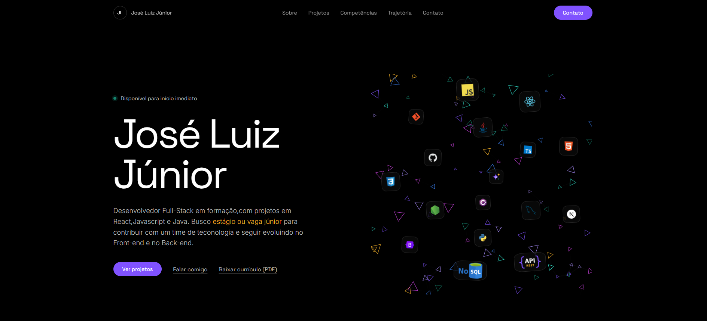
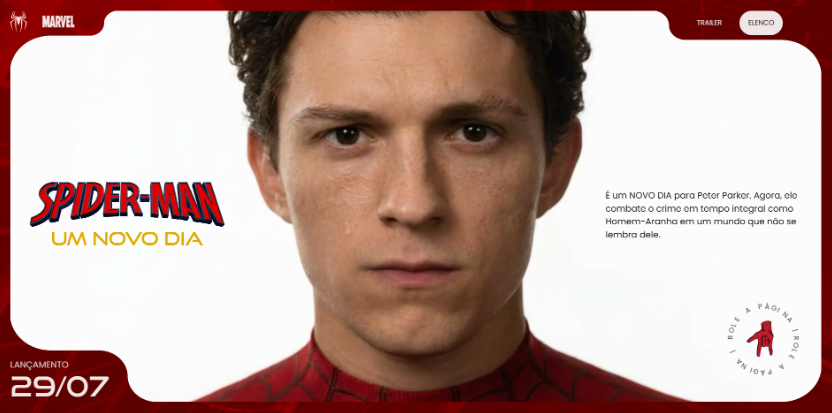
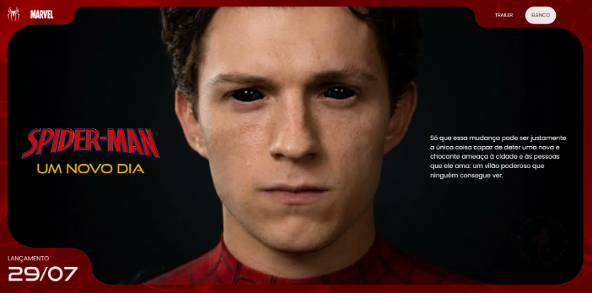
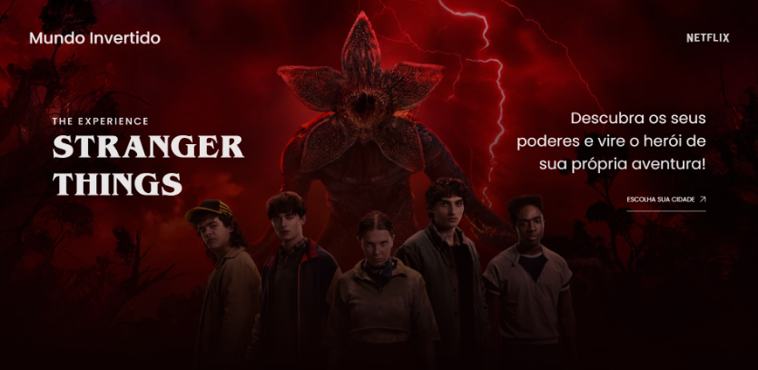
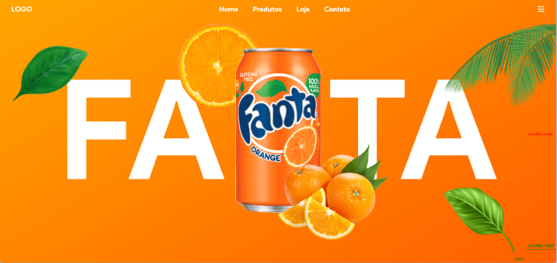
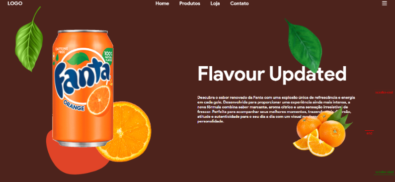
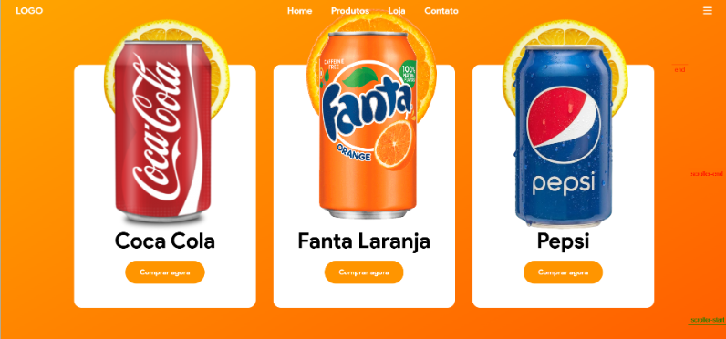
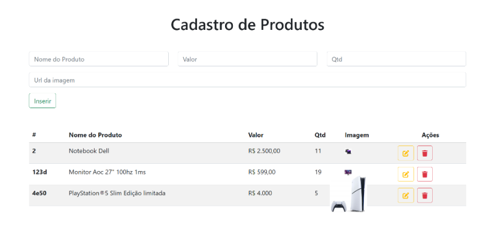
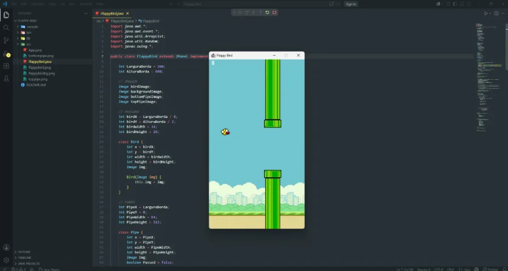
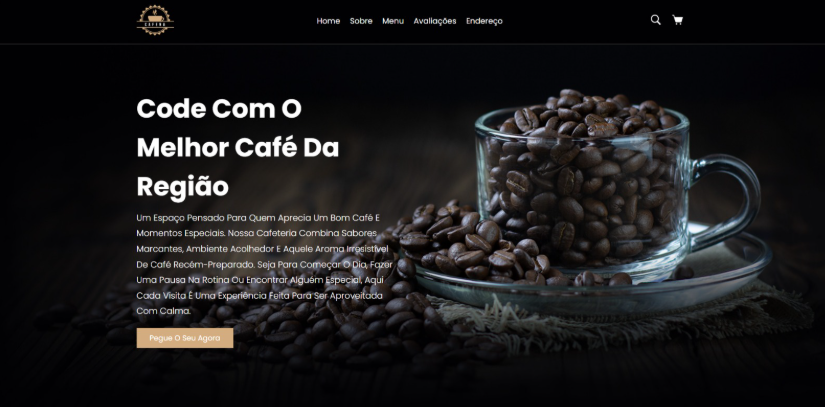

# José Luiz Júnior · Portfólio

Este é o código do meu portfólio: uma página única em HTML, CSS e JavaScript puros, sem framework e sem etapa de build. Ele reúne seis projetos que fiz enquanto estudo front-end (React e GSAP) e lógica de programação (Java), e também serve de vitrine do que consigo construir sem biblioteca: a animação da primeira tela, por exemplo, é um canvas 2D escrito à mão.

Sou estudante de Análise e Desenvolvimento de Sistemas na Universidade Cruzeiro do Sul (conclusão prevista para junho de 2027) e procuro estágio ou vaga júnior em desenvolvimento Front-End, Back-End ou Full Stack.

## Preview Tela Inicial do PórtFólio



## Projetos

Cada projeto tem seu próprio repositório. Aqui está o resumo do que cada um mostra.

### Spider-Man: Um Novo Dia

_Landing page animada, feita a partir de um layout no Figma._

<p>
  
  
</p>

O layout de referência tinha botões sem função. Substituí-os por **Trailer**, que abre um modal com player, e **Elenco**, que faz uma rolagem animada até a seção correspondente.

- Sequência de frames sincronizada com o scroll
- Scroll suave com seções fixas (ScrollSmoother + ScrollTrigger)
- Troca de textos letra a letra com SplitText
- Máscara de revelação, player de vídeo customizado e seção de elenco com crossfade e barra de progresso

**Stack:** HTML, CSS, JavaScript, GSAP, Figma · [Repositório](https://github.com/Joseluizp/Spider-Man)

### Stranger Things: The Experience

_Landing page imersiva._



Experiência visual inspirada na série, com as cidades Hawkins, Mundo Invertido e Sydney e uma proposta de consulta de ingressos. A atmosfera vem da tipografia, da paleta e de animações guiadas pelo scroll.

- Preloader com logotipo SVG animado por `stroke-dashoffset`
- Scroll suavizado e parallax declarativo
- Revelação de caracteres com SplitText
- Rodapé com efeito de sobreposição
- Imagens responsivas com `picture` e `srcset`

**Stack:** HTML, CSS, JavaScript, GSAP, ScrollTrigger, ScrollSmoother, SplitText · [Repositório](https://github.com/Joseluizp/Stranger-Things-Experience)

### Fanta

_Landing page para praticar HTML, CSS e JavaScript._

<p>
  
  
  
</p>

Página inspirada na marca, com efeitos visuais e animações acionadas durante o scroll.

- Três telas com composição forte de elementos
- Animações acionadas pelo scroll
- Seção de produtos com cards

**Stack:** HTML, CSS, JavaScript · [Repositório](https://github.com/joseluizp/Projeto-Fanta)

### Cadastro de Produtos

_Aplicação React com CRUD consumindo uma API._



Simula um sistema simples de estoque e foi feita para praticar componentização, estado e CRUD. Depende de uma API local em execução para funcionar.

- Cadastro, edição e remoção de produtos
- Listagem dinâmica, com a interface atualizada a cada operação
- Consumo de API com operações CRUD

**Stack:** React, `useState`, `useEffect`, Axios, Bootstrap, Font Awesome · [Repositório](https://github.com/joseluizp/cadastro-produtos-react)

### Flappy Bird em Java

_Jogo 2D com Java Swing._



Recriação do clássico para praticar lógica de jogos 2D, eventos, física simples e renderização gráfica.

- Controle pela tecla Space, gravidade e geração de canos
- Pontuação e colisão por bounding box (AABB)
- Loop de 60 FPS com `Timer` e reinício após Game Over
- Renderização manual com `paintComponent`

**Stack:** Java, Swing, AWT · [Repositório](https://github.com/Joseluizp/Flappy-Bird)

### Dev Coffe

_Site de uma cafeteria fictícia._



Tema escuro, com seções de apresentação, sobre, menu, avaliações e endereço.

- Navegação entre seções
- Efeitos de hover e interação com o cursor
- Layout responsivo

**Stack:** HTML, CSS, JavaScript · [Repositório](https://github.com/joseluizp/Dev-Coffe)

## Como o portfólio foi feito

A parte que me interessava aqui era resolver com o que o navegador já oferece, e entender cada decisão.

**Projetos gerados a partir de dados.** Os seis projetos vivem em um array no `script.js`, e a página os transforma em HTML. Cada objeto tem título, descrição, funcionalidades, stack, link do repositório e uma lista de imagens. Adicionar um projeto é adicionar um objeto. Projetos com mais de uma captura ganham miniaturas que trocam a imagem principal, com `aria-pressed` indicando qual está ativa.

**Animação de partículas sem biblioteca.** A primeira tela tem um canvas com partículas triangulares distribuídas dentro de uma silhueta definida por elipses. Partículas próximas se ligam por linhas cuja opacidade depende da distância, e o cursor as empurra quando passa por perto. O canvas só anima enquanto está visível: um `IntersectionObserver` e o evento `visibilitychange` pausam o loop quando a área sai da tela ou a aba fica em segundo plano. A densidade cai de 150 para 95 partículas em telas estreitas e a resolução do canvas é limitada a 2x para não pesar em telas de alta densidade.

**Ícones flutuantes com parallax leve.** Ao redor do canvas flutuam ícones de tecnologia. A posição, o tamanho, a duração e o deslocamento de cada um são definidos como variáveis CSS a partir de uma tabela no script, e o parallax do cursor usa as mesmas variáveis. Se um ícone não carrega, ele é removido em vez de deixar uma imagem quebrada.

**Fontes hospedadas no projeto.** Space Grotesk (títulos, menu, botões e legendas) e Inter (texto corrido) são servidas em `woff2`, em subconjuntos `latin` e `latin-ext` separados por `unicode-range`, com `font-display: swap`. A página não depende do Google Fonts.

**Revelação ao rolar sem biblioteca.** As seções entram com um `IntersectionObserver` simples que adiciona uma classe uma única vez e deixa de observar o elemento.

**Identidade visual.** Fundo preto, texto claro, violeta (`#8052ff`) como cor de ação, açafrão (`#ffb829`) para destaques e verde apenas no indicador de disponibilidade. As cores e o espaçamento ficam em variáveis CSS na raiz.

## Tecnologias

| Onde      | O que                                                                           |
| --------- | ------------------------------------------------------------------------------- |
| Estrutura | HTML5 semântico (`header`, `nav`, `main`, `section`, `article`, `footer`)       |
| Estilo    | CSS puro: variáveis, Grid, Flexbox, `clamp()`, `svh` e `env(safe-area-inset-*)` |
| Interação | JavaScript puro, Canvas 2D e `IntersectionObserver`                             |
| Ícones    | Devicon via CDN (jsDelivr) e três SVGs próprios (`api-rest`, `nosql`, `ia`)     |
| Fontes    | Space Grotesk e Inter, hospedadas no repositório                                |

### O que usei nos projetos e o que ainda estou estudando

**Usadas nos projetos acima:** HTML, CSS, JavaScript, GSAP, ScrollTrigger, React, React Hooks, Axios, Bootstrap, Java, Swing, POO, Git, GitHub e Figma.

**Em estudo:** Node.js, APIs REST, SQL e NoSQL.

## Responsividade e acessibilidade

O que está implementado no código:

- Layout em uma coluna abaixo de 900 px, com menu recolhível que se fecha ao escolher uma seção
- Ajustes adicionais abaixo de 700 px (menos partículas, ícones menores)
- `viewport-fit=cover` e `safe-area-inset` para respeitar as áreas do sistema em celulares
- `lang="pt-BR"`, landmarks com `aria-label`, botão de menu com `aria-expanded` e `aria-controls`
- Canvas e ícones decorativos com `aria-hidden`; imagens dos projetos com texto alternativo
- Estilo de foco visível para navegação por teclado
- Suporte a `prefers-reduced-motion`: a revelação ao rolar, a animação das partículas, a repulsão do cursor, a flutuação dos ícones e a rolagem suave são desativadas

## Executar localmente

O projeto é estático e não tem dependências para instalar.

```bash
git clone <git clone https://github.com/joseluizp/Portfolio.git
>
cd <Portfolio>
```

Depois, abra o `index.html` no navegador. Se preferir um servidor local.

Os ícones de tecnologia da primeira tela vêm de um CDN, então precisam de internet. Sem conexão, eles simplesmente não aparecem, e o resto da página continua funcionando.

### Estrutura

```
.
├── index.html
├── style.css
├── script.js
├── favicon.svg
└── assets/
    ├── fonts/        # Inter e Space Grotesk (woff2)
    ├── api-rest.svg
    ├── nosql.svg
    ├── ia.svg
    ├── spider1.webp, spider2.webp
    ├── stranger.webp
    ├── fanta1.webp, fanta2.webp, fanta3.webp
    ├── cadastro.webp
    ├── flappy.webp
    ├── coffee.png
    └── curriculo.pdf
```

## Contato

- E-mail: [joseluizpereiradsantosjr@gmail.com](mailto:joseluizpereiradsantosjr@gmail.com)
- LinkedIn: [linkedin.com/in/jose-luiz-jr03](https://linkedin.com/in/jose-luiz-jr03)
- GitHub: [github.com/Joseluizp](https://github.com/Joseluizp)
